# Núcleo Transaccional Elástico — TP3 (Terraform)

Cloud Computing · ITBA · 2026Q2 · Grupo 4

Núcleo transaccional de un PSP (proveedor de servicios de pago) desplegado en AWS con Terraform.
Cada usuario tiene una cuenta virtual con la que transfiere a otras cuentas, ingresa y retira
dinero hacia el exterior a través de un proveedor; cada operación se liquida dentro del mismo
request contra un ledger de partida doble en PostgreSQL, y los meses viejos se archivan en S3.

La arquitectura detallada, con el porqué de cada decisión y cómo se aplicaron las correcciones de
las entregas anteriores, está en [`ARCHITECTURE.md`](ARCHITECTURE.md).

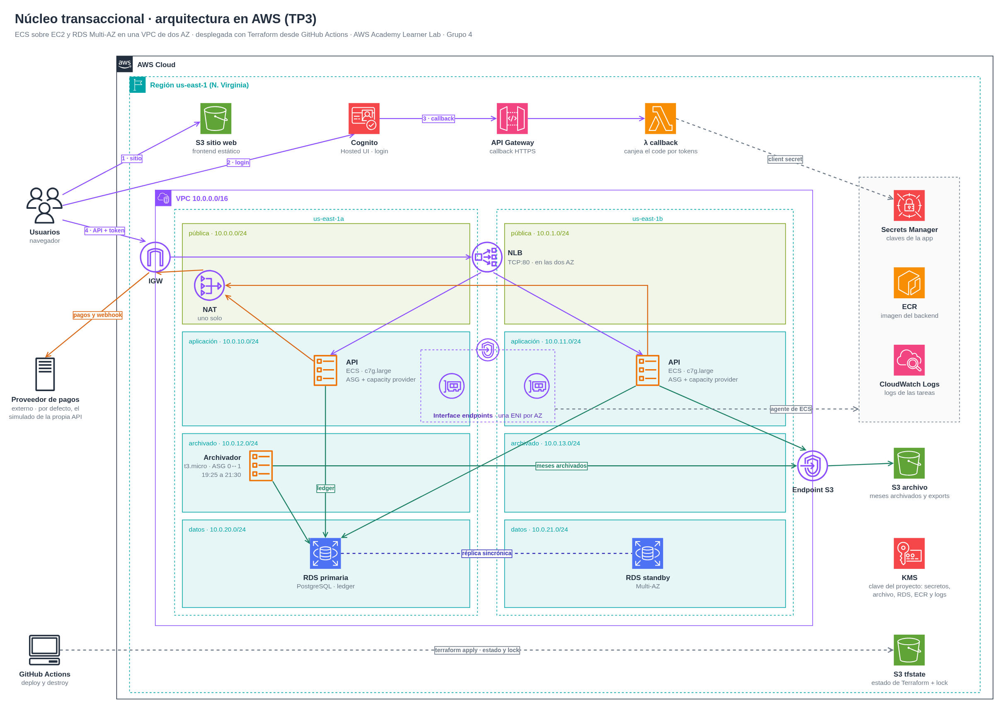

**Flujo de datos:**

1. El navegador baja el frontend del bucket público de S3 (`website_url`) y su `config.json`,
   que Terraform genera con las URL de la API y del login.
2. El login pasa por la Hosted UI de Cognito, que vuelve a un callback HTTPS en API Gateway: una
   Lambda canjea el `code` por tokens y redirige al frontend con ellos.
3. El frontend llama a la API con el access token por el NLB público. El NLB reparte entre las
   tareas de la API, que corren en ECS sobre EC2 en las subredes de `app` de las dos AZ.
4. La API valida el token contra Cognito y liquida cada operación en RDS PostgreSQL Multi-AZ, en
   las subredes de `data`.
5. Los ingresos y egresos hacia el exterior van al proveedor por el NAT. Por defecto es el
   proveedor simulado que trae la propia API en `/servicio-mock`. Si hay `webhook_url`, la API
   avisa ahí cada orden terminada.
6. Todos los días, en la ventana de archivado, ECS levanta una tarea del archivador en las
   subredes de `archive`, que no tienen salida a Internet. Mueve a S3 (`transaction-history/`)
   los meses que superan la retención, por el gateway endpoint.
7. El extracto de un mes archivado lo arma la API leyendo ese objeto de S3; las exportaciones
   del histórico también quedan en el bucket (`exports/`).

Toda la operación (deploy, plan y destrucción) se hace desde **GitHub Actions**: el workflow
**Deploy** aplica todo el Terraform en la cuenta de AWS cuyos secrets tenga el repositorio, y
**Destroy** lo borra todo.

---

## Prerrequisitos

**Desde GitHub Actions** (el camino recomendado) no hace falta nada instalado: alcanza con una
cuenta de AWS Academy y los secrets del paso 1. El laboratorio ya trae `LabRole` y
`LabInstanceProfile`, que es lo que usa el despliegue porque no deja crear IAM.

**Desde una máquina local**, además:

| Herramienta | Versión / nota |
|---|---|
| Terraform | `>= 1.10, < 2.0` (ver [`versions.tf`](terraform/organization/versions.tf)); el pipeline usa 1.16.6 |
| AWS CLI | v2 reciente (`--bucket-namespace` en `create-bucket`) |
| Docker con `buildx` | `make imagen` construye la imagen del backend para amd64 y arm64 |
| Git | Calcula el tag de la imagen del backend (el hash de `apps/ledger`) |
| Make | Ejecuta los comandos del Makefile |
| jq | Lo usa el script que borra los buckets, y sirve para consultar los secretos |

---

## Integrantes

| Nombre | Legajo |
|---|---|
| Agustín Alonso | 63316 |
| Luciano Stupnik | 64233 |
| Tomás Becerra | 63732 |
| Valentino Sanguinetti | 63098 |
| Hannah Hauge Kalager | 69482 |

---

## Pasos a seguir

### 1. Configurar secrets

En el repositorio, **Settings → Secrets and variables → Actions → New repository secret**:

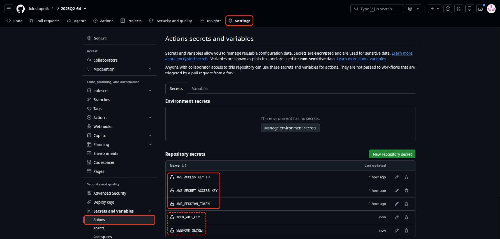

En la captura, el recuadro sólido marca los obligatorios y el punteado dos de los opcionales
(ver abajo).

| Secret | Obligatorio | Para qué |
|---|---|---|
| `AWS_ACCESS_KEY_ID` | Sí | Access key del laboratorio de AWS Academy |
| `AWS_SECRET_ACCESS_KEY` | Sí | Secret access key del laboratorio |
| `AWS_SESSION_TOKEN` | Sí | Session token del laboratorio |

Los tres salen de **AWS Details → AWS CLI** en el laboratorio y vencen con la sesión: hay que
volver a cargarlos cada vez que se inicia el lab, antes de correr un workflow.

**Opcional: conectar un proveedor o un webhook externos.** Sin nada de esto el despliegue usa
el proveedor simulado de la propia API y no avisa a nadie. Para conectarlo con otro sistema (por
ejemplo, el despliegue de otro equipo), en la misma pantalla se cargan estos valores, que Deploy
y el plan del workflow Terraform le pasan a Terraform como `TF_VAR_*`:

| Nombre | Pestaña | Variable de Terraform | Vacío |
|---|---|---|---|
| `PROVEEDOR_URL` | Variables | `proveedor_url` | La API usa su propio `/servicio-mock` |
| `PROVEEDOR_API_KEY` | Secrets | `proveedor_api_key` | La clave del mock propio |
| `MOCK_API_KEY` | Secrets | `mock_api_key` | Se genera una. Fijarla sirve si otro equipo usa este despliegue como proveedor |
| `WEBHOOK_URL` | Variables | `webhook_url` | La API no avisa las órdenes terminadas |
| `WEBHOOK_SECRET` | Secrets | `webhook_secret` | Se genera uno. Tiene que coincidir con el del que recibe los avisos |

Desde una máquina local, los mismos valores van en `terraform/organization/terraform.tfvars`
o como variables de entorno `TF_VAR_*` antes de `make plan`.

### 2. Workflows configurados

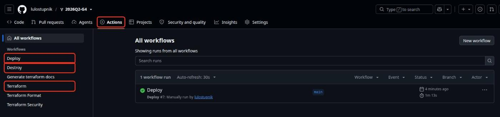

| Workflow | Cuándo corre / confirmación | Qué hace |
|---|---|---|
| **Terraform** | En cada pull request, o a mano | `fmt -check`, `init -backend=false` y `validate` (sin AWS); después `init` y `plan` contra la cuenta. El resultado del plan queda en el resumen del run |
| **Deploy** | A mano, escribiendo `deploy` | `make imagen` (construye la imagen del backend y la sube a ECR; el tag es el hash de `apps/ledger`, así que sólo cambia si cambia el backend), `make plan` y `make apply`. Las URL del despliegue quedan en el resumen del run |
| **Destroy** | A mano, escribiendo `destroy` | `terraform destroy` de toda la infraestructura y después los buckets (archivo, frontend y state) |

Deploy y Destroy comparten un grupo de `concurrency`: nunca corren a la vez sobre el mismo state.

En un pull request que viene de un fork o de dependabot, GitHub no le pasa los secrets al
workflow: ahí
**Terraform** corre `fmt`, `init` y `validate`, y el `plan` aparece como salteado (*skipped*)
en lugar de fallar por falta de credenciales. El `plan` contra la cuenta corre en los pull
requests dentro del mismo repositorio, al lanzar **Terraform** a mano y en cada **Deploy**. Si
el repositorio no tiene los secrets de AWS (o la sesión del laboratorio venció y nadie los
renovó), en un pull request el `plan` también se saltea con un aviso en el resumen del run.

Los workflows que ya traía el repositorio (`terraform-format`, `terraform-docs`, `tfsec`)
corren en paralelo en cada pull request. `terraform-docs` regenera los README de
`terraform/modules/` y trata de commitearlos en la rama del PR, para lo que necesita que el
token del workflow tenga permiso de escritura (un PR desde un fork no lo tiene). Los README de
los módulos ya se commitean generados con terraform-docs, así que no debería encontrar cambios.

### 3. Desplegar

1. Con los secrets cargados: **Actions → Deploy → Run workflow** → rama `main` → escribir
   `deploy`. Mergear no despliega nada, a propósito: las credenciales del laboratorio vencen con
   cada sesión, y un apply que crea RDS Multi-AZ y gasta crédito tiene que ser una decisión
   explícita, no un efecto de mergear. El `plan` sí corre en los pull requests.

   **Desde otra cuenta** (por ejemplo, la de la cátedra): Deploy se lanza a mano y usa los
   secrets del repositorio donde corre, así que hace falta un repositorio propio con este código,
   por ejemplo un fork, con **Actions** habilitado (en un fork nuevo, GitHub lo deja apagado
   hasta tocar *I understand my workflows*) y los tres secrets de AWS cargados. Todos los
   nombres llevan el ID de la cuenta, así que no hay que editar nada.

   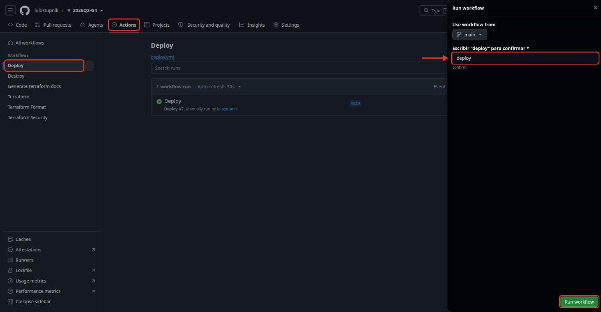

2. Esperar el run en verde. El primer apply tarda más que los siguientes: RDS Multi-AZ sola
   lleva varios minutos.
3. Abrir el resumen del run: tiene `website_url` (frontend), `api_url` y `login_url`.

   

### 4. Probar

Con las URL del resumen del run, verificar que la API responde, con el estado del proceso y de
la base:

```bash
curl <api_url>/health
```

El endpoint devuelve HTTP 200 incluso si la base no responde.
Para comprobar la conexión a PostgreSQL, verificar que el campo
`base` del JSON sea `"ok"`; si falla, devuelve `"sin_respuesta"`
y `estado` pasa a `"degradado"`.

Después, entrar por `website_url`:

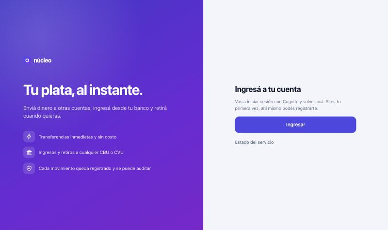

1. **Ingresar** lleva a la Hosted UI de Cognito. La primera vez, **Sign up** con un email y una
   contraseña (8 caracteres, con minúsculas y números). Cognito manda un código a ese email; al
   cargarlo se vuelve al sitio con la sesión iniciada. El registro está abierto, así que no hace
   falta crear usuarios antes.

   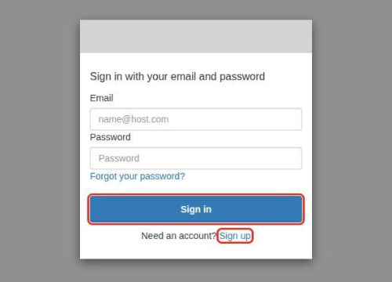

   Si el código no llega (Cognito manda los emails con su remitente por defecto, que tiene un
   límite diario), el usuario se confirma por CLI. El `user_pool_id` está en `terraform output
   cognito`:

   ```bash
   aws cognito-idp admin-confirm-sign-up --user-pool-id <user_pool_id> --username <email>
   ```

2. La primera vez pide un alias y crea la cuenta. Arranca con $ 50.000 de saldo de bienvenida,
   que fija la API (`SALDO_BIENVENIDA_CENTAVOS`) y se asienta contra la cuenta interna de
   ajustes: el cliente no puede elegir con cuánto abre su cuenta.
3. La billetera:
   - **Inicio**: saldo (se puede ocultar), alias para compartir y movimientos recientes.
   - **Enviar**: elegir a quién (con buscador), el monto (valida contra el saldo) y confirmar.
   - **Ingresar**: el monto y un código para usar como concepto de la transferencia; *Ya hice
     la transferencia* simula el aviso del banco.
   - **Retirar**: CBU o CVU de 22 dígitos, el monto y confirmar. Sale por el proveedor: un
     monto terminado en 13 centavos lo rechaza y uno terminado en 99 queda *en revisión* hasta
     que la API lo resuelve por consulta.
   - **Actividad**: mes por mes, con lo que entró, lo que salió y un filtro; el resumen de un
     mes archivado lo arma la API desde S3.
   - Cada operación tiene su comprobante, con el número de operación y su estado.

   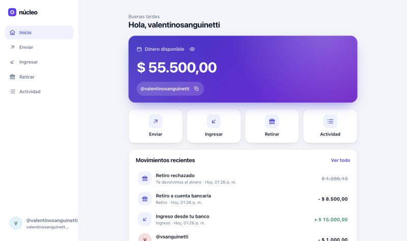

   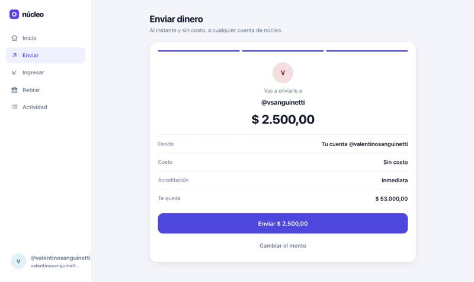

   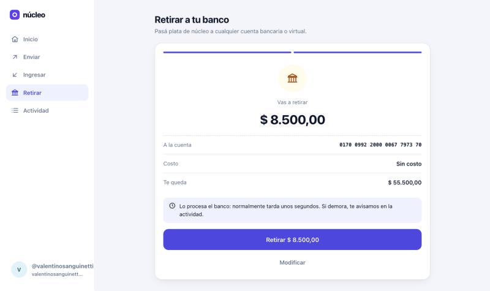

   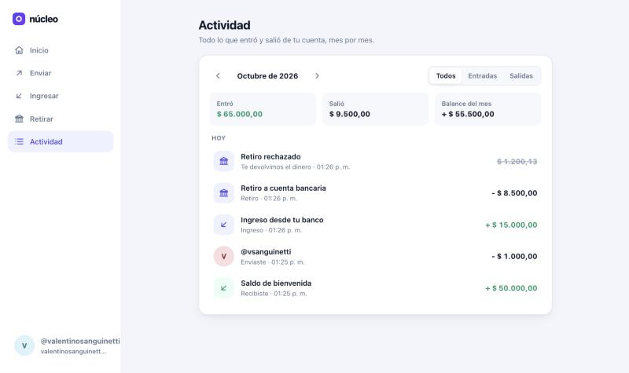

4. **Operación** (salud y qué tarea atendió, proveedor activo, cierre contable, archivado,
   extracto y exportación, y la cinta de llamadas a la API con su código y su latencia) no la
   ve un usuario común: aparece al activar el *Modo operación* desde el menú de la cuenta, con
   la clave de administración (y la del mock para sus tarjetas). Las claves quedan sólo en esa
   pestaña del navegador (`sessionStorage`) y se borran al cerrar sesión. Están en el secreto
   `ledger/api` de Secrets Manager:

   ```bash
   aws secretsmanager get-secret-value --secret-id ledger/api --query SecretString --output text \
     | jq '{ADMIN_API_KEY, MOCK_API_KEY}'
   ```

   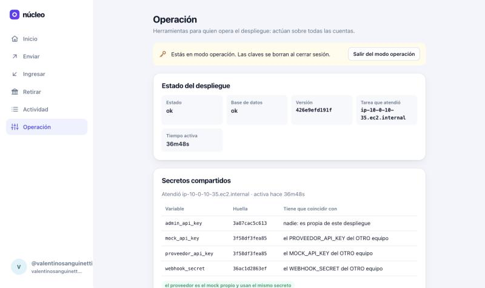

### 5. Destruir al terminar

**Actions → Destroy → Run workflow** → escribir `destroy`.

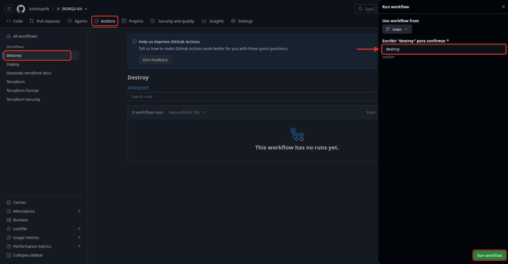

Borra todos los recursos y, cuando el state quedó vacío, también los buckets (ver
[Estado](ARCHITECTURE.md#8-estado)). Sólo quedan la clave KMS, que KMS borra a los 7 días, y
el log group que crea Container Insights (`/aws/ecs/containerinsights/ledger-cluster/performance`,
con retención de un día); ninguno de los dos molesta al próximo Deploy.

### Desde una máquina local

Con las credenciales del laboratorio en `~/.aws/credentials` (o en variables de entorno), los
mismos pasos que el pipeline:

```bash
make init      # crea el bucket del state si no existe e inicializa terraform/organization
make imagen    # construye apps/ledger y la sube a ECR (si ese tag ya está, no hace nada)
make plan      # deja el plan en terraform/organization/tfplan, con ese tag
make apply     # crea los buckets del proyecto si no existen y aplica ese plan
make destroy   # pide confirmación; borra también los buckets
```

`make help` lista el resto (`fmt`, `fmt-check`, `validate`, `clean`). Local y pipeline usan el
mismo state, así que lo desplegado desde un lado se ve y se destruye desde el otro.

---

## Buckets de S3: los crea la AWS CLI

Los tres buckets del proyecto no son recursos `aws_s3_bucket`: los crea
[`scripts/buckets.sh`](scripts/buckets.sh) con `aws s3api create-bucket`, tanto en el pipeline
como desde una máquina local.

| Bucket | Lo crea | Por qué no Terraform |
|---|---|---|
| `ledger-<cuenta>-us-east-1-an` (archivo y exportaciones) | `make apply`, antes del `terraform apply` | El SCP de AWS Academy |
| `ledger-web-<cuenta>-us-east-1-an` (frontend) | `make apply`, antes del `terraform apply` | El SCP de AWS Academy |
| `ledger-tfstate-<cuenta>-us-east-1-an` (state) | `make init` | El backend lo necesita antes del `init` |

**El SCP de AWS Academy.** La política de la organización del laboratorio niega
`s3:GetBucketObjectLockConfiguration` sobre cualquier bucket. El provider de AWS hace esa
lectura cada vez que lee un `aws_s3_bucket`, después de crearlo y en cada refresh, y no tiene
ningún argumento para saltearla: el bucket se crea, pero el apply falla y el recurso queda
*tainted*. Por eso el bucket lo crea la CLI, y Terraform administra todo lo demás con los
recursos que no leen el object lock: versionado, cifrado, bloqueo de acceso público, política,
lifecycle, website y los objetos. Los módulos `storage` y `website` arman el mismo nombre que el
script.

**El bucket del state** se crea aparte por otro motivo: el backend S3 tiene que existir antes de
`terraform init`, así que no puede ser un recurso del mismo state (ver
[Estado](ARCHITECTURE.md#8-estado)).

`make destroy` (y el workflow **Destroy**) borra los tres buckets con todas sus versiones, pero
sólo cuando `terraform destroy` dejó el state vacío. En una cuenta sin ese SCP, los dos buckets
del proyecto serían un `aws_s3_bucket` dentro de cada módulo y el script sólo crearía el del
state.

---

## Módulos

La composición raíz es [`terraform/organization`](terraform/organization): instancia los módulos
y define lo que no pertenece a ninguno: los endpoints de la VPC, el repositorio de ECR y el
cluster de ECS ([`ecs.tf`](terraform/organization/ecs.tf)), las claves generadas y sus secretos
de Secrets Manager ([`secrets.tf`](terraform/organization/secrets.tf)) y la clave KMS del
proyecto ([`kms.tf`](terraform/organization/kms.tf)). Cada módulo propio tiene su README con
las variables y los outputs.

### `terraform-aws-modules/vpc/aws` (externo)

VPC `10.0.0.0/16` con 8 subredes en 4 capas × 2 AZ: `public` (NLB y NAT), `app` (API e
interface endpoints), `archive` (archivador, sin salida a Internet) y `data` (RDS). Crea
también el IGW, un NAT, las tablas de ruteo de cada capa y el subnet group de la base. Los CIDR
y los nombres de las subredes se derivan en [`locals.tf`](terraform/organization/locals.tf).

**Recursos propios junto al módulo** ([`network.tf`](terraform/organization/network.tf)):

- `aws_vpc_endpoint.s3`: gateway endpoint de S3 en las tablas de `app` y `archive`, con una
  política que sólo deja llegar al bucket del proyecto y al de las capas de ECR.
- `aws_vpc_endpoint.interface`: un interface endpoint por servicio que necesita el agente de
  ECS (`ecs`, `ecs-agent`, `ecs-telemetry`, `ecr.api`, `ecr.dkr`, `logs`, `secretsmanager`), en
  las subredes de `app`, que sólo acepta credenciales de la propia cuenta.

**Versión:** `~> 6.7`.

---

### [`modules/security_groups`](terraform/modules/security_groups)

Un security group por capa (`nlb`, `app`, `archive`, `data`), más los de los hosts de ECS
(`host`) y los interface endpoints (`endpoints`). Las reglas salen de una sola tabla en
`locals` y referencian grupos o la prefix list de S3, no rangos: sólo el NLB acepta tráfico de
Internet y sólo la API sale a Internet.

**Recursos:** `aws_security_group.this`, `aws_vpc_security_group_ingress_rule.this` y
`aws_vpc_security_group_egress_rule.this`.

---

### [`modules/storage`](terraform/modules/storage)

Bucket privado del proyecto: el archivo del ledger (`transaction-history/`) y las exportaciones
(`exports/`). Versionado, cifrado con la clave KMS del proyecto (SSE-KMS con bucket key), con
bloqueo de acceso público y una política que rechaza cualquier pedido que no venga por HTTPS.
El lifecycle borra las versiones reemplazadas a los 30 días y pasa el archivo a STANDARD_IA a
los 30 días y a GLACIER al año.

El bucket lo crea `make apply` con la AWS CLI y el módulo lo configura (ver
[Buckets de S3](#buckets-de-s3-los-crea-la-aws-cli)).

**Recursos:** `aws_s3_bucket_versioning.this`,
`aws_s3_bucket_server_side_encryption_configuration.this`,
`aws_s3_bucket_public_access_block.this`, `aws_s3_bucket_policy.this` y
`aws_s3_bucket_lifecycle_configuration.this`.

---

### [`modules/website`](terraform/modules/website)

Bucket público con website hosting (HTTP) para el frontend de [`apps/web`](apps/web). Sube un
objeto por archivo con su `Content-Type`, y publica `config.json` con lo que el frontend no
puede saber hasta el apply (`api_url`, `login_url`, `logout_url`). Se cifra con AES256 y no con
KMS: los usuarios anónimos del sitio no pueden tener permiso sobre una clave.

Como el de `storage`, el bucket lo crea `make apply` con la AWS CLI (ver
[Buckets de S3](#buckets-de-s3-los-crea-la-aws-cli)).

**Recursos:** `aws_s3_bucket_website_configuration.this`,
`aws_s3_bucket_policy.public_read`, `aws_s3_object.site` y `aws_s3_object.config`.

---

### [`modules/auth`](terraform/modules/auth)

User pool de Cognito con Hosted UI (login por email) y un app client con client secret. Como
Cognito sólo acepta callbacks HTTPS, suma una HTTP API de API Gateway con las rutas `/callback`
y `/logout` hacia una Lambda ([`apps/callback`](apps/callback)) que canjea el `code` por tokens
(ver [Login con Cognito](ARCHITECTURE.md#6-login-con-cognito)). El client secret está en Secrets
Manager (`ledger/callback`) y la Lambda sólo recibe su ARN. El stage de API Gateway manda un
access log JSON por request a su propio log group.

**Recursos:** `aws_cognito_user_pool.this`, `aws_cognito_user_pool_domain.this`,
`aws_cognito_user_pool_client.this`, `aws_secretsmanager_secret.client`,
`aws_lambda_function.callback`, `aws_apigatewayv2_api.this` y sus rutas, integración y stage.

---

### [`modules/database`](terraform/modules/database)

RDS PostgreSQL Multi-AZ en las subredes de `data`, cifrada con la clave KMS del proyecto y sin
acceso público. Expone la `DB_URL` de los binarios, con TLS obligatorio.

**Recursos:** `aws_db_instance.this`.

---

### [`modules/load_balancer`](terraform/modules/load_balancer)

NLB público con un listener TCP:80 y el target group de la API. Los targets son las IP de las
tareas, que ECS registra solo, y el health check es HTTP a `/health`.

**Recursos:** `aws_lb.this`, `aws_lb_target_group.api` y `aws_lb_listener.http`.

---

### [`modules/capacity`](terraform/modules/capacity)

Las instancias de un servicio de ECS: launch template con la AMI optimizada para ECS (sale de
SSM, según la arquitectura de la instancia), el disco raíz cifrado e IMDSv2 obligatorio, un ASG
y el capacity provider que lo escala según las tareas. Para la API se configura
`target_capacity = 80`, con el objetivo de mantener capacidad de reserva y reducir
la espera al iniciar nuevas tareas. Esto no garantiza un arranque inmediato:
puede ser necesario lanzar nuevas instancias.

**Recursos:** `aws_launch_template.this`, `aws_autoscaling_group.this` y
`aws_ecs_capacity_provider.this`.

---

### [`modules/service`](terraform/modules/service)

Un servicio de ECS: task definition con red `awsvpc`, el servicio con circuit breaker, el log
group cifrado y el autoscaling de las tareas, por CPU (la API) o por horario (el archivador).
La task definition separa las variables comunes de las secretas: éstas son referencias
(`valueFrom`) a Secrets Manager, y ECS lee el valor al arrancar la tarea (ver
[Secretos y cifrado](ARCHITECTURE.md#5-secretos-y-cifrado)).

**Recursos:** `aws_ecs_task_definition.this`, `aws_ecs_service.this`,
`aws_cloudwatch_log_group.this`, `aws_appautoscaling_target.this`,
`aws_appautoscaling_policy.cpu` y `aws_appautoscaling_scheduled_action.this`.

`capacity` y `service` se instancian una vez por servicio (API y archivador) con `for_each`
sobre `local.services`; ver [Cómputo](ARCHITECTURE.md#3-cómputo).

---

## Funciones y meta-argumentos de Terraform

### Funciones utilizadas

| Función | Dónde | Para qué |
|---|---|---|
| `cidrsubnet` | `organization/locals.tf` | Deriva los CIDR de cada capa desde el de la VPC |
| `slice` | `organization/locals.tf` | Toma las dos primeras AZ de la región |
| `range` | `organization/locals.tf` | Una subred por AZ dentro de cada capa |
| `substr` | `organization/locals.tf` | Saca la letra de la AZ para el nombre de la subred (`ledger-app-a`) |
| `floor`, `sum`, `values` | `organization/locals.tf` | Reparte `db_max_connections` entre las tareas: el tope de cada una va en la `DB_URL` (`pool_max_conns`) |
| `coalesce` | `organization/locals.tf` | Usa la clave o la URL que se pasó por variable y, si está vacía, la generada o la propia |
| `tostring` | `organization/locals.tf` | El puerto de la API como variable de entorno |
| `concat` | `organization/network.tf` | Asocia el endpoint de S3 a las tablas de app y archivado |
| `replace` | `organization/network.tf`, `modules/security_groups/main.tf`, `modules/database/main.tf` | Arma nombres: el `Name` de cada endpoint y de cada regla (`app_in_nlb` → `ledger-app-in-nlb`), y el de la base sin guiones |
| `try` | `modules/security_groups/main.tf` | Usa el SG de destino sólo si el `peer` de la regla es otro grupo |
| `format` | `modules/storage/main.tf`, `modules/website/main.tf`, `modules/auth/main.tf`, `modules/database/outputs.tf` | Arma los nombres de los buckets, la URL del dominio de Cognito y la `DB_URL` |
| `jsonencode` | `organization/network.tf`, `organization/kms.tf`, `organization/secrets.tf`, `modules/storage/main.tf`, `modules/website/main.tf`, `modules/service/main.tf`, `modules/auth/main.tf` | Las políticas de los endpoints, de la clave KMS y de los buckets, el contenido de cada secreto, el `config.json` del frontend, las `container_definitions` y el formato de los access logs |
| `nonsensitive` | `organization/main.tf` | Los nombres de las variables secretas no son secretos: así se pueden recorrer para armar cada `valueFrom` |
| `toset` | `organization/network.tf`, `organization/secrets.tf`, `modules/auth/main.tf` | Un elemento por endpoint, por clave generada y por ruta de API Gateway |
| `fileset` | `modules/website/main.tf` | Lista los archivos del frontend para subir uno por uno |
| `regex`, `lower`, `contains`, `keys` | `modules/website/main.tf` | Saca la extensión y publica sólo los tipos conocidos |
| `filemd5` | `modules/website/main.tf` | Hash de cada archivo: se vuelve a subir sólo si cambió |
| `length` | `modules/website/main.tf` | Publica `config.json` sólo si hay `runtime_config` |
| `urlencode`, `join` | `modules/auth/outputs.tf` | Arma las URL de login y logout de la Hosted UI |
| `templatefile` | `modules/capacity/main.tf` | El `user_data` de las instancias, con el nombre del cluster |
| `format`, `contains` | `modules/capacity/main.tf` | Elige el parámetro de SSM de la AMI arm64 si el tipo de instancia admite esa arquitectura |
| `base64encode` | `modules/capacity/main.tf` | El `user_data` va codificado en el launch template |
| `sort`, `keys` | `modules/service/main.tf` | Las variables de entorno en orden fijo: el plan no muestra cambios espurios |
| `alltrue`, `contains` | `organization/variables.tf` | Valida que el archivador vaya de 0 a 1 tarea |
| `contains` | `modules/auth/variables.tf`, `modules/service/variables.tf` | Valida que la retención de los logs sea una que acepta CloudWatch |

### Meta-argumentos utilizados

| Meta-argumento | Dónde | Para qué |
|---|---|---|
| `for_each` | `organization/main.tf` (`module "capacity"`, `module "service"`) | Instancias y servicio de ECS para la API y el archivador sin duplicar código |
| `for_each` | `organization/network.tf` | Un interface endpoint por servicio de AWS que necesita el agente de ECS |
| `for_each` | `organization/secrets.tf` | Las cuatro claves generadas (`db`, `admin`, `mock`, `webhook`) y un secreto de Secrets Manager por servicio |
| `for_each` | `modules/security_groups/main.tf` | Un SG por capa y una regla por fila de la tabla de reglas |
| `for_each` | `modules/website/main.tf` | Un objeto de S3 por archivo del frontend |
| `for_each` | `modules/auth/main.tf` | Las rutas `/callback` y `/logout` hacia la misma integración |
| `for_each` | `modules/service/main.tf` | Una acción programada por cada entrada de `schedule` (abrir y cerrar la ventana del archivador) |
| `count` | `modules/website/main.tf` | Publica `config.json` sólo si hay `runtime_config` |
| `count` | `modules/service/main.tf` | La política de escalado por CPU sólo en los servicios que la piden (la API) |
| `depends_on` | `organization/main.tf` (`module "capacity"`) | Al destruir, las instancias y los servicios de ECS se borran antes que los endpoints y los security groups que usa su agente |
| `depends_on` | `modules/auth/main.tf` | El log group de la Lambda existe antes que ella, con retención y dentro del state |
| `depends_on` | `modules/storage/main.tf`, `modules/website/main.tf` | La política de cada bucket se aplica después de su bloqueo de acceso público |
| `depends_on` | `modules/storage/main.tf` | El lifecycle se aplica después del versionado, porque expira versiones anteriores |
| `lifecycle` | `modules/service/main.tf` | `ignore_changes = [desired_count]`: la cantidad de tareas la maneja el autoscaling, no Terraform |
| `lifecycle` | `modules/capacity/main.tf` | `ignore_changes = [desired_capacity]`: la cantidad de instancias la maneja el capacity provider |

### Validación de variables

Los bloques `validation` comprueban los valores de entrada: limitan `archive_schedule` a 0 o 1
tarea, `log_retention_days` a los valores que admite CloudWatch y `target_capacity` al rango de
1 a 100. Están en `organization/variables.tf`, `modules/auth/variables.tf`,
`modules/service/variables.tf` y `modules/capacity/variables.tf`, y un valor inválido falla en
el `plan`, no a mitad del apply.

### Bloques `dynamic`

| Dónde | Para qué |
|---|---|
| `modules/storage/main.tf` | Una regla de lifecycle por prefijo, con sus transiciones |
| `modules/service/main.tf` | El bloque `load_balancer` del servicio sólo si tiene target group (la API sí, el archivador no) |

### Data sources

| Data source | Dónde | Para qué |
|---|---|---|
| `aws_availability_zones` | `organization/providers.tf` | Las AZ disponibles de la región |
| `aws_caller_identity` | `organization/providers.tf`, `modules/storage`, `modules/website`, `modules/auth` | La cuenta: va en los nombres de los buckets, en el dominio de Cognito y en las políticas de los endpoints y de la clave KMS |
| `aws_region` | `modules/storage`, `modules/website`, `modules/auth`, `modules/service` | La región, sin pasarla como variable a cada módulo |
| `aws_iam_role`, `aws_iam_instance_profile` | `organization/providers.tf` | `LabRole` y `LabInstanceProfile`: AWS Academy no deja crear IAM. El ARN de `LabRole` también va en la política de la clave KMS |
| `aws_ec2_instance_type` | `modules/capacity/main.tf` | La arquitectura del tipo de instancia (x86 o arm64) |
| `aws_ssm_parameter` | `modules/capacity/main.tf` | La AMI optimizada para ECS recomendada para esa arquitectura, sin fijar un ID |
| `archive_file` | `modules/auth/main.tf` | El zip de la Lambda del callback |

---

## Mapa del repositorio

```
.
├── .github/workflows/     # Terraform (validate + plan), Deploy, Destroy y los que ya traía el repo
├── Makefile               # init (con el bucket del state), imagen, plan, apply, destroy, fmt, validate
├── ARCHITECTURE.md        # red, cómputo, secretos y cifrado, login, state y trade-offs
├── img/                   # diagrama de arquitectura (.png y .drawio) y capturas de los pasos
├── scripts/
│   └── buckets.sh         # crea y borra los buckets: el del state y los del proyecto
├── terraform/
│   ├── organization/      # composición raíz: acá se corre terraform
│   └── modules/           # módulos propios
│       ├── security_groups/
│       ├── storage/       # bucket privado: archivo del ledger
│       ├── website/       # bucket público: frontend
│       ├── database/
│       ├── load_balancer/
│       ├── auth/          # Cognito + API Gateway + Lambda: callback HTTPS del login
│       ├── capacity/      # instancias de ECS: launch template, ASG y capacity provider
│       └── service/       # servicio de ECS: task definition, servicio y autoscaling
└── apps/
    ├── ledger/            # backend en Go: binarios api y archivador, imagen con su Dockerfile
    ├── web/               # frontend estático (lo sube modules/website)
    └── callback/          # Lambda del callback de Cognito (JavaScript, sin dependencias ni build)
```

Arquitectura y decisiones de diseño: [`ARCHITECTURE.md`](ARCHITECTURE.md).
